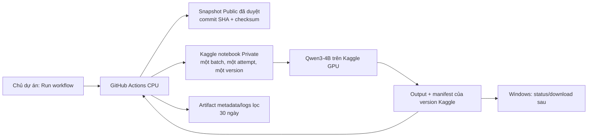

# Phase D2 — Thiết kế batch Qwen3-4B trên Kaggle

**Ngày:** 2026-11-07  
**Trạng thái:** kiến trúc được phê duyệt **có điều kiện cho D2-1 offline**. Chưa được Kaggle push/live run/GPU, công bố snapshot, cấu hình credential thật, commit/push GitHub, chạy POC hoặc 100 từ.  
**Nguồn quyết định:** [KAGGLE_BATCH_AUTOMATION_CONTEXT.md](KAGGLE_BATCH_AUTOMATION_CONTEXT.md).

## 1. Mục tiêu và ranh giới

- Một nút `workflow_dispatch` trên GitHub khởi động POC 5 từ hoặc, sau các cổng phê duyệt riêng, công việc 100 từ. GitHub Actions chỉ điều phối và xác minh trên CPU; Qwen3-4B chỉ suy luận trên Kaggle GPU. Windows có thể tắt sau khi kích hoạt.
- POC D2 dùng đúng `004, 009, 041, 054, 065`, chỉ Variant B, tối đa 5 lượt generation. D1 A+B qua API V4 tiếp tục là thí nghiệm độc lập.
- Lần mở rộng danh nghĩa 100 từ dùng Variant B, một kết quả cho mỗi ID, tối đa 100 lượt generation trong đường chạy không lỗi. Runner có tham số A, B, A+B để nghiên cứu sau, mặc định B. Variant C nếu có là thí nghiệm riêng.
- Không sửa notebook API V4, pipeline Qwen3-1.7B, dữ liệu/asset production hoặc báo cáo lịch sử; không Cloudflare Tunnel, HTTP API batch, schedule, GitHub Actions larger runner, tự commit/push hoặc tự đưa kết quả vào production.
- Quyết định 5A cho phép khôi phục batch chưa thành công, nhưng một phiên bị gián đoạn có thể đã tiêu tốn generation trước khi mất checkpoint. **Không thể đồng thời bảo đảm tuyệt đối tổng số generation của mọi attempt ≤100 và tự chạy lại mọi batch dở.** Thiết kế bảo toàn trần tự động: trước retry, nếu không chứng minh tổng số lượt đã dùng cộng lượt dự kiến còn lại vẫn trong trần được duyệt, dừng để chủ dự án duyệt ngân sách bổ sung. POC không tự retry trong mọi trường hợp.

## 2. Cơ sở đã xác minh và điều chưa chứng minh

| Điểm | Bằng chứng / hệ quả thiết kế |
|---|---|
| Kaggle Save & Run All | [Kaggle Notebooks](https://www.kaggle.com/docs/notebooks) mô tả một phiên sạch, tạo version chứa source, logs và output sau khi hoàn tất. File đang ghi trong phiên bị hủy chưa được bảo đảm là checkpoint. |
| Kaggle CLI | [Tài liệu `kernels`](https://github.com/Kaggle/kaggle-cli/blob/main/docs/kernels.md) có `push`, `pull`, `status`, `files`, `output`, `logs`, version trong ref và `push -t <seconds>`. [Changelog 2.2.5](https://github.com/Kaggle/kaggle-cli/blob/main/CHANGELOG.md) sửa lỗi các lệnh bỏ qua version. Chỉ bản 2.2.5 được đề xuất để thử; hành vi tài khoản thật chưa kiểm chứng. |
| Kaggle metadata | [Hợp đồng metadata](https://github.com/Kaggle/kaggle-cli/blob/main/docs/kernels_metadata.md) có `id`, `title`, `code_file`, `is_private`, `enable_gpu`, `enable_internet`, `machine_shape`; `NvidiaTeslaT4` chỉ GPU T4 ×2. Quyền cấp máy cụ thể và quota của tài khoản cần preflight. |
| Kaggle quota / hủy | [Changelog CLI](https://github.com/Kaggle/kaggle-cli/blob/main/CHANGELOG.md) ghi có `kaggle quota`; [tài liệu CLI](https://github.com/Kaggle/kaggle-cli/blob/main/docs/kernels.md) không có lệnh cancel phiên đang chạy. [Đề xuất cancel](https://github.com/Kaggle/kaggle-cli/issues/1172) còn mở. Không cam kết hủy GPU từ Actions hoặc dừng cứng đúng phút 60. |
| GitHub Actions | [Standard runner miễn phí cho repository Public](https://docs.github.com/en/actions/reference/runners/github-hosted-runners); [mỗi job tối đa 6 giờ, workflow tối đa 35 ngày](https://docs.github.com/en/actions/reference/limits). [Nút chạy thủ công cần workflow trên default branch](https://docs.github.com/en/actions/how-tos/manage-workflow-runs/manually-run-a-workflow). |
| Artifact | [GitHub cho đặt `retention-days`](https://docs.github.com/en/actions/tutorials/store-and-share-data); 30 ngày được chọn. Người có quyền đọc repository có thể tải [workflow artifact](https://docs.github.com/en/actions/how-tos/manage-workflow-runs/download-workflow-artifacts), nên artifact chỉ chứa metadata và logs đã lọc. |
| Revision Hugging Face | `revision` của Transformers có thể là commit ID theo [tài liệu Auto classes](https://huggingface.co/docs/transformers/model_doc/auto); [Hub `model_info`](https://huggingface.co/docs/huggingface_hub/en/package_reference/hf_api) cung cấp thông tin revision, gồm SHA khi có. POC phải ghi SHA thực dùng, lần 100 từ phải ghim SHA đó. |

Tài liệu chính thức không chứng minh output Kaggle tồn tại vô hạn, `push -t` cưỡng chế dừng GPU đúng 60 phút, hoặc phiên bản lỗi/hủy vẫn tải đủ file. Các điểm đó là cổng thử nghiệm, không phải giả định vận hành.

## 3. Thành phần và dữ liệu

**Snapshot đầu vào** là một thư mục mới, chứa đúng 100 ID ổn định, EN/JP/VN, các trường nghĩa đã được phê duyệt cần cho Variant B và prompt B gốc. Prompt gồm system text nguyên văn trong `reports/image_pipeline_benchmark/20261106-image-query-v1/prompts.json` và cách tạo user text hiện có (`Vocabulary record (JSON): ` cộng JSON với đúng tên trường/thứ tự/encoding và cách `json.dumps(..., ensure_ascii=False)` hiện tại). Trước khi công bố phải so từng byte, SHA-256 và prompt render của 5 ID với manifest D1; không rút ngắn hay diễn giải lại. Không đưa ảnh, MP3, cache, token, file tạm hoặc dữ liệu ngoài phạm vi.

**Notebook template** được tạo riêng cho D2. Actions gắn một manifest đầu vào bất biến vào bản notebook sẽ push: experiment ID, mode `poc`/`full`, batch ID, attempt, thứ tự ID, variant, snapshot commit/hash, prompt hash, giới hạn generation, thời hạn. Như vậy bản source của chính version Kaggle đủ để đối chiếu ngay cả khi Actions bị hủy trước khi upload artifact. Không có secret trong notebook/source; Kaggle credential chỉ nằm ở GitHub Secrets trên runner.

Trong POC, notebook phân giải `main` thành một commit SHA Hugging Face **một lần trước khi tải tokenizer và model**, dùng chính SHA đó cho cả hai và ghi SHA vào manifest. Nếu không lấy được SHA hoặc hai thành phần không xác minh cùng revision, dừng trước inference. Lần 100 từ lấy SHA đã xác minh từ POC làm revision bắt buộc; không âm thầm quay lại `main`.

**Định danh dự kiến:** `experiment_id` là ID bền vững được chủ dự án duyệt trong catalog bất biến cùng input fingerprint; GitHub run ID chỉ ghi dấu lần dispatch. Với mỗi batch/attempt, dùng slug riêng dạng `knight3007/qwen3-4b-vocab-<mode>-<experiment_id>-bNN-aNN`; title tương ứng để Kaggle sinh slug đúng quy tắc. Mỗi slug chỉ được push một lần và phải có đúng **version 1**. Nếu slug đã tồn tại, kiểm tra `owner/slug/1`; không cập nhật notebook đó. Retry dùng `a02`, `a03`... Khi khôi phục, liệt kê toàn bộ notebook bằng CLI có phân trang, lọc prefix experiment/batch, rồi đối chiếu từng slug/version. Cần kiểm tra giới hạn slug, khả năng liệt kê đầy đủ và version 1 với tài khoản thật; nếu khác, dừng trước POC.

### Ba phát hiện review bắt buộc trước D2-1

1. **Pending concurrency:** [GitHub hiện ghi](https://docs.github.com/en/actions/how-tos/write-workflows/choose-when-workflows-run/control-workflow-concurrency) `cancel-in-progress: false` vẫn cho phép pending workflow cũ bị pending mới thay thế theo mặc định. Workflow nháp dùng một group cố định, `cancel-in-progress: false`, `queue: max` để giữ tối đa 100 pending. Không dựa vào thứ tự dispatch/FIFO: mọi workflow khi được chạy đều đối chiếu catalog và Kaggle lại từ đầu. Nếu `queue: max` không được tài khoản/phiên bản GitHub chấp nhận khi kiểm chứng triển khai, dừng; không lặng lẽ trở về `queue: single`.
2. **Hai GitHub run ID, một thí nghiệm:** fingerprint lấy từ snapshot hash, prompt hash, mode, ordered IDs, variant, model policy và generation settings. Catalog `approved_experiments.json` hiện rỗng ở D2-1; không có ID được duyệt thì live command/workflow phải từ chối trước khi push. Hai dispatch khác GH run ID nhưng cùng `experiment_id` chỉ được reconcile cùng Kaggle slugs, không chạy lại. Một ID khác có cùng fingerprint cũng bị từ chối, trừ khi catalog ghi rõ `repeat_of`, lý do và phê duyệt riêng của chủ dự án. Resume phải dùng lại ID cũ. Catalog chỉ được đưa lên GitHub sau bước audit/commit/push có phép.
3. **GPU ngoài Actions:** Kaggle CLI `kernels status` chỉ phản ánh version notebook được hỏi; không chứng minh không có phiên API V4 tương tác hoặc phiên GPU khởi chạy trực tiếp. Preflight kiểm tra các notebook D2 biết được và các phiên Kaggle có thể liệt kê. Phần không quan sát được có fallback bảo thủ: workflow đòi chủ dự án xác nhận dành riêng Kaggle GPU cho toàn bộ logical experiment và không khởi động V4/direct GPU tới khi batch kết thúc; checkbox mặc định false. Không xác nhận hoặc phát hiện phiên khác đang chạy → dừng trước push. Đây là cam kết thao tác của chủ dự án, không phải khóa kỹ thuật cưỡng chế; không sửa, tự dừng hay đụng V4.

## 4. Luồng một lần kích hoạt và điều phối tuần tự

1. `workflow_dispatch` nhận `mode=poc|full|resume`, `experiment_id` được duyệt và xác nhận dành riêng GPU mặc định false. Resume dùng ID cũ. Catalog rỗng ở D2-1 nên bản nháp không thể kích hoạt live. Workflow chỉ xuất hiện trên default branch sau phê duyệt commit/push riêng; không dùng trigger tự động.
2. Workflow checkout **commit SHA đầu vào đã được duyệt**, kiểm tra SHA-256 của snapshot và notebook template, đúng tập ID và prompt B nguyên văn. Nếu khác thì thất bại trước khi gọi Kaggle. Không lấy đầu vào từ branch đang trôi.
3. Preflight: kiểm tra catalog/fingerprint và trùng thí nghiệm trước mọi Kaggle call; xác nhận dành riêng GPU; sau đó mới kiểm tra Kaggle credential từ GitHub Secrets, quyền truy cập Private, CLI version, quota nếu CLI trả dữ liệu, model/Internet/T4 khả dụng ở mức có thể kiểm tra mà không chạy GPU; kiểm tra các slug/attempt cũ và các phiên đang chạy. Không ghi secret hoặc raw output vào logs Actions. Phiên V4 tương tác không quan sát được qua CLI phải dựa vào cam kết dành riêng GPU của chủ dự án; thiếu cam kết thì fail closed.
4. Với batch chưa hoàn tất, trước push phải đối chiếu slug và version dự kiến. Chỉ khi chắc chắn chưa có phiên cũ chạy và không có kết quả đã xác minh mới tạo **một** notebook Private mới. Từ CLI push, lưu version thực trả về; nếu không chứng minh version khớp `1`, dừng. Không coi exit code `0` hoặc status `latest` là bằng chứng thành công.
5. Poll `owner/slug/1` với timeout của **Actions** ngắn hơn 6 giờ/job. Khi Kaggle hoàn tất, tải output của **version 1** vào thư mục tạm riêng trên runner; kiểm manifest, đủ file, ID/thứ tự, variant, prompt/model/snapshot hash, số record và SHA-256 từng file. Chỉ sau xác minh mới đánh dấu collection complete. Nếu thiếu/mâu thuẫn, dừng; không push batch kế.
6. Kiểm tra parse Variant B. Nếu lỗi, giữ raw/hash/error trên Kaggle, quality=`needs_review`, workflow dừng và không retry. POC chỉ qua cổng kỹ thuật khi đủ 5 raw/hash và 5/5 parse; sau đó chờ chủ dự án đánh giá ngữ nghĩa. Mọi output mới luôn nằm ngoài production.
7. Chỉ khi batch đạt cổng tương ứng, job kế tiếp mới xét batch kế. Sau batch cuối, tải/kiểm tra lại mọi version trước khi tạo tập kết quả 100 từ vào một thư mục mới, không ghi đè; tạo báo cáo đối chiếu 4B Variant B với 1.7B Variant B đã có mà không chạy lại 1.7B. Không tự commit/push tập kết quả.

GitHub `concurrency` cố định cho toàn bộ D2 trên tài khoản Kaggle này với `cancel-in-progress: false` và `queue: max`. Theo [tài liệu GitHub hiện tại](https://docs.github.com/en/actions/how-tos/write-workflows/choose-when-workflows-run/control-workflow-concurrency), chỉ một workflow trong group chạy cùng lúc, tối đa 100 pending khi dùng `queue: max`; **không giả định thứ tự dispatch được bảo toàn**. Concurrency không bao trùm phiên Kaggle mồ côi/V4, nên kiểm tra Kaggle và xác nhận dành riêng GPU vẫn bắt buộc trước mỗi push. Dispatch trùng cùng experiment ID hoặc fingerprint không được tạo generation mới.

## 5. Trạng thái, checkpoint và kiểm chứng

| Trục | Trạng thái | Điều kiện |
|---|---|---|
| Kaggle execution | `not_found`, `queued/running`, `complete`, `error`, `unknown` | Lấy từ **version cụ thể**; `unknown` luôn dừng an toàn. |
| Collection | `not_started`, `incomplete`, `verified_complete` | `verified_complete` chỉ khi version hoàn tất và đủ manifest, raw/parsed/error files, ID, số record, checksum. File tạm `/kaggle/working` khi còn chạy không phải checkpoint bền vững. |
| Quality | `not_evaluated`, `parse_valid`, `needs_review`, `owner_approved` | Parse là kiểm tra cấu trúc; đánh giá ngữ nghĩa của chủ dự án là bước riêng. `needs_review` không tự retry và không mở batch kế. |
| Production | `not_promoted` | D2 không tự thay đổi production. |

Manifest output per attempt gồm: schema version; experiment/batch/attempt; Kaggle owner/slug/version **dự kiến**; mode, variant, ID và input snapshot commit/hash; toàn bộ prompt đã render và SHA-256; model ID, revision yêu cầu và SHA thực dùng; tokenizer/library/Python/CUDA/GPU metadata; thời điểm UTC; các mốc setup/download/load/inference/finalize; mỗi record có raw text, parsed object hoặc lỗi parse, token đầu vào/đầu ra theo tokenizer, latency, SHA-256 raw; checksum và kích thước của từng file output; số generation thực bắt đầu/kết thúc; completion reason. Notebook không tự suy ra version thực nếu Kaggle không cấp; **Actions ledger** ghi version trả từ push và kiểm tra nó bằng CLI. Không tự tạo `finish_reason` nếu Transformers không cung cấp. Manifest không tự hash chính nó để tránh vòng lặp; Actions hash byte manifest khi tải và kiểm tra các file được manifest khai báo. Bản ghi thiếu trường bắt buộc là `incomplete`.

Một batch chỉ là checkpoint có thể bỏ qua khi collection=`verified_complete`, quality=`parse_valid`, đúng snapshot/model policy và tất cả checksum kiểm lại được. Dữ liệu parse lỗi vẫn là bằng chứng lưu trữ, nhưng chưa phải batch thành công. POC cần 5/5 parse và người dùng xem ngữ nghĩa trước mọi đề xuất chạy 100 từ.

## 6. Resume, artifact hết hạn và hủy workflow

**Nguồn sự thật** là các notebook/version Private trên Kaggle, không phải artifact GitHub. Artifact 30 ngày chỉ chứa ledger nhỏ (experiment/batch/attempt/slug/version, hash manifest, trạng thái, timestamps, quota estimate) và logs đã lọc. Không chứa raw output hoặc prompt đầy đủ. Sau 30 ngày, lệnh `status --experiment-id` và workflow `resume` dựng lại ledger: tính danh sách batch từ snapshot đã ghim, liệt kê notebook theo prefix experiment ID với phân trang, tải source/version và output manifest của từng `owner/slug/1`, xác minh experiment ID, batch, checksum và trạng thái. Nếu không liệt kê được đầy đủ, có hơn một version trong một slug, khoảng trống attempt, thiếu source/output cần thiết hoặc thông tin mâu thuẫn, dừng và báo cần đối chiếu thủ công; không dùng `latest` thay version cụ thể.

Nếu Actions bị hủy **sau push**, Kaggle có thể tiếp tục chạy. Resume thấy `running` thì chỉ báo và chờ ở lần kiểm tra sau; không push attempt mới. Nếu Kaggle đã hoàn tất và output hợp lệ, đánh dấu batch đó thành công và bỏ qua. Nếu xác minh được phiên trước đã lỗi/timeout và không còn chạy, một lần `workflow_dispatch` resume có thể tạo attempt kế cho batch chưa thành công, với điều kiện còn trong budget được duyệt. Nếu trạng thái hoặc số generation đã tiêu tốn không xác định, dừng an toàn. `needs_review` luôn dừng chờ đánh giá, không tự chạy lại.

Nếu Actions bị hủy **trong lúc push** và không tìm thấy slug/version ngay, không giả định push thất bại. Reconcile lặp lại trong cửa sổ hữu hạn; nếu vẫn không xác minh được experiment ID/version/checksum, báo `unknown` và dừng. Việc kiểm tra Kaggle UI hoặc can thiệp thủ công là bước xử lý trường hợp bất định, không phải retry tự động. Hủy Actions không dừng GPU. CLI chưa có lệnh cancel được tài liệu hóa; chủ dự án có thể dừng phiên bất thường thủ công trong Kaggle UI. Một phiên bị hủy trước khi hoàn tất có thể không có output dùng làm checkpoint.

Trên Windows sau này có một lệnh `status --experiment-id <id>` để đối chiếu Kaggle và một lệnh `download --experiment-id <id>` để tải vào `reports/kaggle_batch_runs/<experiment_id>/` theo thư mục/filename mới. Cả hai phải xác minh checksum; `download` từ chối ghi đè. Nếu Kaggle đã xóa output hoặc tài khoản không truy cập được, công cụ báo không thể khôi phục; thiết kế không hứa lưu trữ vĩnh viễn trên Kaggle.

## 7. Thời gian, quota và một lần nhấn cho 100 từ

**POC:** đồng hồ đơn điệu khởi tạo ở cell đầu tiên của phiên thực thi Kaggle, trước cài dependencies/tải model; không tính từ khi nhấn nút GitHub. Nếu Kaggle cung cấp mốc bắt đầu phiên sớm hơn, phải đối chiếu để tính trần bảo thủ. Thời gian container trước cell đầu có thể không quan sát được từ notebook, nên không tuyên bố kiểm soát đúng từng giây từ lúc Kaggle cấp GPU. Trong notebook, sau phút 50 không khởi động generation mới; ghi kết quả/manifest/logs và thoát ngay khi xong. Sau phút 60 nếu chưa hoàn tất thì trạng thái `timeout` hoặc `incomplete`, không thành công, không tự retry. `kaggle kernels push -t 3600` được dự kiến làm chốt bổ sung theo CLI, nhưng chưa xác minh mốc tính hoặc khả năng lưu output khi bị cắt; không dùng nó làm bảo đảm dừng GPU chính xác. Actions có timeout riêng và không suy ra trạng thái Kaggle từ timeout đó.

**100 từ:** chỉ chọn kích thước batch (ban đầu cân nhắc 10–25) sau khi có số đo POC. Ước tính quota theo công thức `ceil(100/b) × (setup + download + load + finalization) + 100 × inference_B + thời gian chờ/dao động`, với `b` là số từ/batch. Trước POC phải đọc quota còn lại (CLI hoặc, nếu CLI không trả số đáng tin cậy, kiểm tra thủ công trong Kaggle UI) và bảo đảm đủ cho giới hạn 60 phút cộng dự phòng an toàn; nếu không xác minh được thì dừng trước push GPU. Mỗi batch 100 từ có timeout riêng dưới 6 giờ của job Actions và trong quota còn lại; trước mỗi batch kiểm tra số giờ còn lại và **budget đã được chủ dự án duyệt**. Nếu thiếu số đo quota, không thể xác minh quota qua CLI/UI, hoặc dự kiến vượt trần, dừng trước push. Số đo POC dùng đề xuất buffer và trần số học, không mặc định lấy 60 phút × số batch. T4 ×2 là loại máy được yêu cầu, nhưng cách Kaggle trừ quota theo máy/giờ phải đọc từ tài khoản thật; không nhân đôi hoặc chia đôi giờ quota theo suy đoán.

Để một lần nhấn vẫn chạy được khi tổng công việc >6 giờ, workflow dự kiến có tối đa 10 job CPU **tuần tự**, mỗi job xử lý tối đa một batch 10–25 từ; slot không dùng làm no-op và báo success để chuỗi `needs` tiếp tục. Job kế có `needs` vào job trước và tự dựng lại trạng thái từ Kaggle, không dựa vào artifact làm checkpoint. Nếu POC cho thấy một batch 10 từ có nguy cơ vượt thời hạn an toàn dưới 6 giờ/job, chưa chạy 100 từ mà sửa phương án để duyệt lại. Tổng workflow cũng chịu [giới hạn 35 ngày](https://docs.github.com/en/actions/reference/limits), dù dự kiến ngắn hơn nhiều. Không có bộ điều phối thứ hai hay GitHub Actions schedule.

## 8. Bảo mật và lưu trữ

- GitHub Secrets chỉ chứa Kaggle credential. Workflow giới hạn quyền `GITHUB_TOKEN` ở mức đọc nội dung và quyền thật sự cần cho artifact; không truyền secret sang notebook, không in stdout/debug. External actions nên ghim full commit SHA theo [hướng dẫn bảo mật GitHub](https://docs.github.com/en/actions/reference/security/secure-use).
- Snapshot trong GitHub Public phải được rà soát secrets/PII/bản quyền/đường dẫn riêng tư. Báo cáo công bố ghi chính xác tên file, byte size, SHA-256 và diff; chủ dự án duyệt nội dung trước commit/push. Workflow checkout commit SHA được duyệt và kiểm tra checksum, không nhận tùy ý một commit khác qua input.
- Kaggle metadata đặt `is_private=true`, `enable_gpu=true`, `enable_internet=true` khi tải model cần mạng, machine shape T4 nếu tài khoản hỗ trợ. Source notebook không chứa token; logs không in prompt/raw output trừ file output Private cần thiết. Lỗi trong Actions được lọc trước khi upload artifact.
- Output raw, parsed, prompt, manifest, benchmark timing và logs đầy đủ nằm trong version Kaggle Private. GitHub artifact 30 ngày chỉ có metadata/logs đã lọc, nên mức dùng storage thấp; sau khi artifact hết hạn vẫn xác minh lại từ Kaggle. Workflow logs gốc của GitHub có cài đặt retention riêng: trước khi công bố workflow, kiểm tra/đề xuất đặt 30 ngày ở repository settings; nếu chưa được phép đổi setting, log gốc chỉ được chứa thông tin đã lọc và báo rõ thời hạn thực. Không tự xóa notebook/version hay output cũ.
- Dữ liệu tải về nằm trong thư mục mới theo experiment ID/attempt; hợp nhất 100 từ là artifact dẫn xuất, chỉ tạo sau khi kiểm chứng toàn bộ nguồn, không ghi đè bất kỳ file lịch sử nào và không cập nhật production.

## 9. File D2-1 được phép tạo hoặc sửa offline

Danh sách này là phạm vi D2-1 local được phép triển khai. Không công bố, commit/push hay kích hoạt live trong D2-1.

| File/nhóm | Mục đích | Giai đoạn |
|---|---|---|
| `kaggle_batch/notebook_template.ipynb` | Notebook inference D2 tự chứa, không API/Tunnel; tạo bản riêng cho từng batch/attempt. | Offline |
| `kaggle_batch/notebook_runtime.py` | Nguồn Python được chèn vào notebook, ghi raw/parsed/manifest/log và thời gian từng pha. | Offline |
| `kaggle_batch/driver.py` | CLI CPU cho lập batch, render notebook/metadata, preflight, push, poll, verify, resume, status, download, merge. | Offline |
| `kaggle_batch/snapshot.py`, `kaggle_batch/__init__.py` | Tạo snapshot từ nguồn read-only và giữ package D2 riêng. | Offline |
| `kaggle_batch/tests/test_driver.py` và fixtures nhỏ | Mô phỏng hai batch, cancel sau push, artifact hết hạn, hash sai, parse lỗi, duplicate, quota/timeout; không gọi GPU. | Offline |
| `batch_inputs/d2_v1/vocabulary_100.json` | Snapshot tối thiểu 100 ID và các trường ngữ nghĩa B cần dùng, chờ audit Public. | Offline/audit |
| `batch_inputs/d2_v1/variant_b_prompt.json` | Prompt B nguyên văn, định dạng user JSON cố định, hash. | Offline/audit |
| `kaggle_batch/approved_experiments.json` | Catalog rỗng trong D2-1; chỉ ID được chủ dự án duyệt riêng mới được chạy live, chống dispatch trùng khác GH run ID. | Offline |
| `.github/workflows/kaggle_qwen3_4b_batch.yml` | `workflow_dispatch`, CPU jobs tuần tự, global concurrency, artifact 30 ngày. Chỉ xuất hiện trên GitHub sau duyệt commit/push. | Offline, rồi công bố có phép |
| `docs/KAGGLE_BATCH_AUTOMATION_CONTEXT.md` và tài liệu này | Quyết định, ba phát hiện review, tiến độ và cổng phê duyệt. | D2-1 |

Không sửa notebook V4, `data/vocabulary/`, pipeline 1.7B, production assets hoặc báo cáo lịch sử. Thư mục `reports/kaggle_batch_runs/<experiment_id>/` chỉ được tạo bởi lệnh tải về sau này, với file mới và kiểm tra không ghi đè.

## 10. Phase triển khai và cổng nghiệm thu

| Phase | Công việc và bằng chứng cần có | Cổng |
|---|---|
| D2-0: duyệt thiết kế | Chủ dự án đã phê duyệt có điều kiện, yêu cầu xử lý ba phát hiện review trước code. | **Đã mở D2-1 offline**, chưa mở D2-2/D2-3. |
| D2-1: chuẩn bị offline | Đọc V4 ở chế độ read-only, tạo notebook D2/driver, đóng băng prompt và snapshot, tạo hai batch giả lập; kiểm tra không chạm file bảo vệ. | Test offline chứng minh tuần tự, đúng version/hash, duplicate không push, cancel sau push khôi phục được hoặc dừng an toàn. Không GPU. |
| D2-2: audit và công bố có phép | Báo cáo danh sách file, byte size, SHA-256, diff, quét secrets/PII/bản quyền; chủ dự án duyệt từng file trước commit/push. Sau đó mới đặt GitHub Secret ngoài chat và đưa workflow lên default branch để có nút chạy. Đọc thử CLI tài khoản; `push --no-run` chỉ nếu được cho phép riêng để xác minh version mà không chạy GPU. | Phê duyệt commit/push/snapshot và mọi live no-run push cụ thể; không suy diễn từ duyệt kiến trúc. |
| D2-3: POC live | Chỉ sau phê duyệt GPU riêng, chạy 5 ID, B, tối đa 5 generation, 60 phút từ Kaggle start; xác minh đúng version và output; báo thời gian từng pha, quota đã dùng, SHA model, so sánh với 1.7B B có sẵn. | 5 raw/hash, 5/5 parse, owner xem chất lượng ngữ nghĩa; lỗi → `needs_review`, không auto retry hoặc auto chạy 100. |
| D2-4: thiết kế 100 từ | Từ số đo POC tính batch size, timeout/job, quota trần và buffer; kiểm tra quota tài khoản; trình chủ dự án duyệt riêng. | Chưa chạy 100 từ khi chưa có trần số học và phê duyệt live 100. |

**Nghiệm thu thiết kế trước D2-1:** bảy quyết định được giữ; ba phát hiện review và giới hạn quan sát phiên V4 đã được ghi rõ; không coi artifact 30 ngày là checkpoint. D2-1 chỉ là triển khai offline, không tự cấp quyền live.

**Nghiệm thu offline trước GPU (D2-1/D2-2):** hai batch giả lập chạy tuần tự; batch 2 chỉ mở sau khi batch 1 có exact version + manifest + record count + checksum hợp lệ; duplicate và canceled-after-push không tạo inference mới; artifact giả lập hết hạn vẫn dựng được trạng thái từ Kaggle giả; thiếu version/hash dừng; parse lỗi giữ raw và `needs_review`; không ghi đè; snapshot/prompt hash và 5 ID POC đúng; audit Public được duyệt; notebook mới Private và secret không xuất hiện trong source/log. Sau đó cần **phê duyệt GPU riêng**.

**Nghiệm thu sau POC:** báo cáo exact version, 5/5 raw/hash/parse, semantic review của chủ dự án, SHA Hugging Face thực dùng, thời gian setup/download/load/từng inference/finalization, GPU quota đã tiêu và chi phí Actions. Nếu bất kỳ điều kiện bắt buộc nào không đạt, giữ output và dừng ở `needs_review`.

## 11. Chi phí, rủi ro và điều kiện dừng

| Khoản | Dự kiến | Chưa biết / điều kiện |
|---|---|---|
| GitHub Actions CPU | **0 USD tiền runner** khi repository còn Public và chỉ dùng standard GitHub-hosted runner, theo [GitHub](https://docs.github.com/en/actions/reference/runners/github-hosted-runners). | Nếu đổi visibility/runner, phải tính lại. 30 ngày artifact metadata nhỏ nhưng vẫn kiểm tra [giới hạn storage theo plan](https://docs.github.com/en/billing/concepts/product-billing/github-actions). |
| Kaggle GPU POC | **0 USD tiền mặt nếu nằm trong quota miễn phí**, tối đa thiết kế 60 phút wall time của phiên Kaggle; mục tiêu là kết thúc ngay khi xong. | Quota thực của tài khoản, thời gian cấp máy, download/load/inference chưa đo. Không hứa GPU tắt cứng đúng 60 phút. |
| Kaggle GPU 100 từ | **0 USD tiền mặt nếu đủ quota miễn phí**; dự kiến 4–10 batch nếu chọn 10–25 từ/batch, nhưng chưa chốt. | Tổng giờ GPU phải tính từ POC, gồm tải model lặp mỗi batch; báo trần số học và buffer để duyệt. Retry có thể tăng giờ và số generation. |
| GitHub artifact | Metadata/logs đã lọc 30 ngày, dung lượng dự kiến nhỏ. | Không có số byte trước khi có schema/log thực; không dùng làm nguồn phục hồi lâu dài. |

Các rủi ro có thể chặn POC: tài khoản thiếu quota/T4/Internet hoặc không tạo được notebook Private; CLI 2.2.5 không cho đối chiếu version chính xác; slug/version không phù hợp với mô hình một attempt một notebook; Kaggle không lưu output khi bị timeout; prompt/snapshot audit Public chưa được duyệt. Khi gặp bất kỳ rủi ro này, dừng trước push GPU hoặc trước batch kế, ghi rõ bằng chứng và sửa thiết kế để duyệt lại. Không dùng API Kaggle chưa được tài liệu hóa để cưỡng chế hủy phiên.

## 12. Kết quả D2-1 offline và giới hạn bản nháp

- Code local đã tạo đúng các file ở mục 9; `approved_experiments.json` có danh sách rỗng, vì vậy không có experiment ID nào có thể qua `approval` gate. Không có Kaggle CLI live call, GPU, credential thật, commit hoặc push trong D2-1.
- Lệnh kiểm thử: `python -m unittest discover -s kaggle_batch/tests -v`; **19 test đạt**. Fake Kaggle kiểm chứng hai batch tuần tự, batch 2 đọc đúng source/output version 1 của batch 1, dispatch trùng cùng ID hoặc khác GitHub run ID không push thêm, fingerprint trùng dưới ID mới bị chặn, hủy Actions sau push khi Kaggle còn `running` không tạo attempt mới, artifact mất nhưng Kaggle còn bằng chứng thì dựng lại được, thiếu/mâu thuẫn version/manifest/checksum dừng. Parser notebook được thử với JSON hợp lệ, sai và EOS thiếu. Lỗi parse giữ raw và `needs_review`. Retry tự động chỉ dành cho `resume` của full run nếu version lỗi xác minh được **0 generation**; POC không tự retry, generation đã dùng/không rõ thì dừng.
- Snapshot Public ứng viên hiện có đúng hai file: `vocabulary_100.json` 41.522 byte, SHA-256 `7bcdd41280111663e34a983ee9d11d60ee94fc673f81cdddcf7294323b4e4282`; `variant_b_prompt.json` 1.784 byte, SHA-256 `c6833a80929badfeeb9f613417bc824d5b624ca3fd1ba7206ba0c1a546dffc33`. Snapshot chỉ có 100 ID, EN/JP/VN, trạng thái và trường nghĩa/usage dùng trong B; không chứa media, cache, kết quả lịch sử. Prompt B đúng 1.560 ký tự; 5 user prompt POC khớp D1 A+B manifest ở từng ký tự. Quét mẫu token, đường dẫn máy riêng, email và URL không thấy tín hiệu; vẫn cần chủ dự án đọc và duyệt công bố từng file.
- Workflow nháp có một `approval` job CPU và tối đa 10 batch jobs nối bằng `needs`, mỗi job dưới 330 phút, một group concurrency cố định với `queue: max` và `cancel-in-progress: false`. Code/catalog lấy từ `main` của lần dispatch; snapshot được checkout thêm tại **commit SHA đầu vào đã duyệt** vào `approved-input`, đối chiếu SHA-256 với catalog và snapshot tại code checkout, rồi mới cho phép CLI. Commit snapshot có thể có trước commit cập nhật catalog, tránh tham chiếu SHA vòng lặp. Các batch sau chỉ được push khi tất cả batch trước được xác minh. Metadata và event log đã lọc của mỗi job dùng artifact 30 ngày. GitHub platform logs có chính sách lưu riêng, cần kiểm tra/cấu hình retention ở repository trước công bố. Artifact không phải ledger bền vững.
- `status` và `download` đọc lại source/output của đúng slug `/1` trên Kaggle Private. `download` chỉ tạo `reports/kaggle_batch_runs/<experiment_id>/` mới, gộp sau khi mọi batch hợp lệ, tạo so sánh với Variant B Qwen3-1.7B có sẵn (hiện chỉ 25 bản ghi lịch sử trong `query_experiment.json`), không chạy lại model local. Workflow không tự gộp lên production.
- **D2-2 bắt buộc kiểm chứng live read-only trước GPU:** định dạng CSV của `kernels list -v`, chuỗi `kernels status`, tính đúng version của `pull`/`output`, cú pháp/giá trị `kaggle quota`, quyền notebook Private/T4/Internet và slug. Thông báo version của `kernels push` chỉ có thể kiểm chứng bằng bài thử **`--no-run` live push được duyệt riêng**; không giả vờ rằng thao tác read-only chứng minh điều này. Adapter CLI cố ý từ chối định dạng không nhận ra. D2-1 chỉ chứng minh logic với mock, chưa chứng minh CLI 2.2.5 tương thích tài khoản.
- **Giới hạn chưa khắc phục:** Kaggle CLI không xác nhận vắng phiên V4/direct GPU; cần chủ dự án dành riêng GPU và không mở phiên khác. `kaggle kernels push -t 3600` được tài liệu hóa là timeout nhưng chưa chứng minh hủy cứng đúng 60 phút; timer notebook bắt đầu tại code cell, có thể không bao gồm thời gian Kaggle cấp máy. Output của phiên lỗi/hủy có thể không tồn tại; trong trường hợp đó resume dừng an toàn. **Adapter CLI quota và kiểm chứng slug vắng mặt hiện cố ý dừng trước push** vì schema quota và lookup 404/độ trễ cập nhật danh sách chưa được xác minh; mock offline trả số giây quota và kiểm tra absence. D2-2 phải bổ sung/kiểm chứng parser số học, ngưỡng, negative lookup và cờ phê duyệt trước POC. Không âm thầm bỏ qua cổng này.
