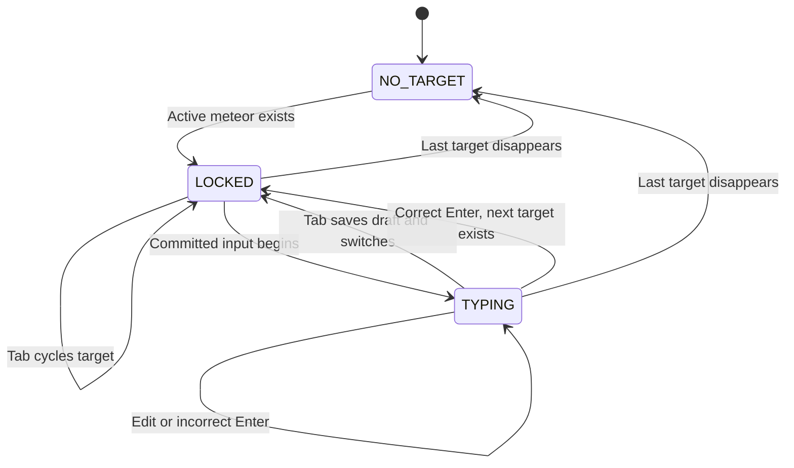
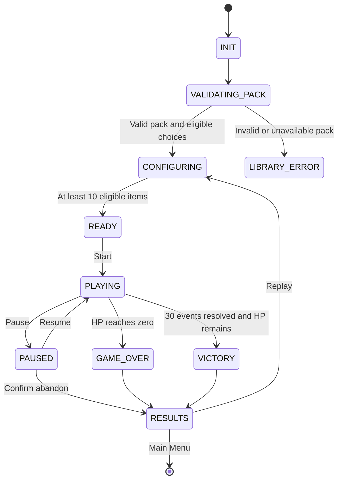

# Gameplay Mechanics Specification v0.1 — DRAFT

> **Owner decision 2026-11-27 (D-034):** the standalone Flashcard feature (G-005) is **CANCELLED — merged into the Vocabulary Library**. Viewing a word, its Vietnamese meaning, the shared image and the selected-language pronunciation stays in the Vocabulary Library; there is no separate Flashcard screen, card flip or review mode, and no Flashcard entry in the Main Menu. Phase numbers are not renumbered. Flashcard mentions below are historical unless marked otherwise.

**Task:** G-002 gameplay refinement before G-003. **Status:** Documentation ready for owner review, 2026-11-26. This specification records the owner's choices for the planning draft; numerical balance, visual selection and Unity behavior remain unapproved and untested. The [GDD](GDD_v0.1.md) owns product scope, [User Flow](USER_FLOW_v0.1.md) owns routes, and [Content Pack v1](../contracts/content_pack_v1.md) owns item readiness and media validation.

## 1. Authority and capability boundaries

**CONFIRMED product requirements:** Meteor Defense and Flashcard are the two primary features. Combat is typing the source-language vocabulary for an English–Vietnamese or Japanese–Vietnamese question. A correct answer destroys a meteor and plays pronunciation for the chosen source language. Normal gameplay reads existing Content Packs and never runs AI inference. Vietnamese pronunciation is not generated. The separate [background plan](../../game/background/background_idea.md) remains the protected primary visual reference.

**Owner choices for this draft:** `NO_HINT` retains Vietnamese meaning; use a finite 3-wave × 10-spawn session; prefer Windows Japanese IME; combine automatic targeting with Tab; retain a separate partial answer per meteor; count a wrong answer only on Enter; wrong answers reset combo without HP damage; hide selected character units in Fill-in-the-Blank; `TEXT_ONLY` adds the first source character. These choices are **PREFERRED for the proposed gameplay design**, not authorization to implement or proof of playability. Other values below are **PROPOSED** until playtesting.

| Existing GDD capability ID | Gameplay responsibility | Depends on | Independent check |
|---|---|---|---|
| `content-pack-runtime` | Load immutable snapshot, enforce ready/media rules, retain pack/item identity | Content Pack v1 | Contract and fixture tests |
| `game-configuration` | Select pack/language/difficulty/answer/hint; count eligible items | `content-pack-runtime` | Eligibility cases |
| `vocabulary-input` | Committed input, puzzle generation and answer comparison | `game-configuration` | Deterministic text tests |
| `meteor-defense` | Session, spawning, targeting, collision, HP, score and waves | `vocabulary-input`, `game-configuration` | Logic tests, then Unity Play Mode |
| `multimedia-playback` | Selected-language speech, SFX and volume priority | `content-pack-runtime` | Asset tests, then Unity/manual |
| `learning-results` | Aggregate outcomes and attempts by `item_id` | `meteor-defense` | Deterministic result tests |
| `flashcard` | Review weak items using the same Content Pack | `content-pack-runtime`, `learning-results` | Separate Flashcard task |
| `application-shell` | S01–S11 routes, pause and result navigation | Displayed capabilities | Unity/manual |

Dependency order is Content Pack → configuration/input → Meteor Defense/multimedia → results → Flashcard review. `local-ai-integration` and `desktop-distribution` retain their separate GDD milestones. This document adds no capability ID or competing roadmap.

## 2. Item eligibility and question compatibility

Freeze `(pack_id, pack_version)` and configuration when a session starts. A question needs an item with `status=ready`, valid selected-language text and meaning, and media validated under Content Pack v1. For a dual-language pack, the selected language must map to its matching audio field; never use Japanese audio for English or the reverse. Readiness is not inferred from a file existing. No runtime mutation of the immutable pack, review state or quality evidence is permitted. A corrupt/missing required asset disables the item and produces a library diagnostic; a one-off playback device failure after validation is reported without fabricating replacement media or stopping gameplay.

The session needs **10 distinct eligible items**. Each wave uses 10 distinct items; later waves may reuse them. Choose without repetition within a wave using a recorded session seed, and never assign the same item to two active meteors. If fewer than 10 remain after filtering, S06 shows the count and blocks Start. The recorded real trial packs have zero `ready` items; they are not currently a playable library. A separately labeled synthetic prototype set would need its own authorization and must not be presented as reviewed vocabulary.

| Hint mode | `FULL_WORD` in EN/JA | `FILL_IN_THE_BLANK` in EN/JA | Additional eligibility |
|---|---|---|---|
| `NO_HINT` | Vietnamese meaning is the question; enter entire source term | Vietnamese meaning plus puzzle; enter hidden units | No extra clue or image; exclude source answers that share the same Vietnamese clue in the session pool |
| `TEXT_ONLY` | Vietnamese meaning plus first source character | Same clue plus puzzle; first source character is shown separately | No image required; exclude ambiguous clue/first-character combinations |
| `TEXT_AND_IMAGE` | Text Only clues plus image | Text Only clues, image and puzzle | Reviewed, valid image required; exclude ambiguous questions |
| `IMAGE_ONLY` | Image alone identifies the source answer | Image plus source puzzle | Reviewed, valid and sufficiently distinguishing image required; no Vietnamese meaning is shown |

> **2026-11-27 owner decision (D-043):** image hints are not used in gameplay. Only `NO_HINT` and `TEXT_ONLY` are implemented; the two image rows above are kept for history only. Images remain in the Vocabulary Library.

Every row also requires valid selected-language audio. An identical image reused by different source answers cannot distinguish them in `IMAGE_ONLY`; exclude those item/configuration pairs. An image's technical validity does not alone establish semantic distinctiveness. Use only the Content Pack's review evidence and conservative collision checks; unresolved ambiguity is an owner content-review issue. S06 shows the filtered count and does not silently switch hint/answer modes.

## 3. Answer construction and multilingual entry

`FULL_WORD` accepts the full source-language term. The difficulty hidden-character percentage does not apply. `FILL_IN_THE_BLANK` displays source units with selected units replaced by blanks; the player types only missing units in displayed order. Example: `pineapple` → `p _ n e _ p p l e` → `ia`; `りんご` → `り _ ご` → `ん`. The answer is reconstructed in the original positions before comparison. Repeated characters require an entry for each hidden position.

Generate puzzles from Unicode text elements after NFC normalization. Keep combining marks attached to their base, and preserve small Kana, Kanji and the long-vowel mark `ー` in their original sequence. Spaces and punctuation are displayed, never selected as blanks. Require at least one hidden and one visible source text unit. Exclude words too short to meet both conditions or puzzle cases that cannot be rendered/read clearly. Use a recorded per-session seed so a failed puzzle can be reproduced. The target hidden ratio is rounded to available units, then clamped to the one-hidden/one-visible rule. In `TEXT_ONLY`, the first source unit is always displayed as the separate textual hint; this may be redundant when that unit is already visible in the puzzle, a playtest question rather than a reason to change the owner's selected hint rule silently.

The input field stores **committed** text separately from uncommitted IME composition. Backspace edits committed text only after the IME has handled its own composition. Space remains a character in a multi-word English answer; punctuation within a term is required in `FULL_WORD`. Enter validates only when composition is inactive. A wrong Enter increments the current item's wrong-attempt count, gives a compact visual/error sound cue, resets combo, retains the target and editable input, and does not reduce HP. A correct Enter consumes the target exactly once.

> **2026-11-27 owner requirement (D-044):** the ship fires at the targeted meteor while the player types. Each newly committed correct answer unit fires one laser and advances that meteor's damage bar; a wrong unit gives error feedback without damage; the last correct unit destroys the meteor without Enter (the full-answer comparison below remains the final gate). Unfinished IME composition never deals damage. Exact per-unit rules are provisional (see DECISIONS D-044).

Normalize both expected and submitted text to NFC and trim leading/trailing whitespace. English comparison ignores letter case but preserves interior spaces and punctuation; it does not guess alternate spacing or spellings. Japanese comparison requires the stored script and characters after NFC: no automatic Hiragana/Katakana, Kanji/Kana, half/full-width or long-vowel substitution. Imported Excel may contain Kanji, and neither the Excel nor pack contract promises a reading or Romaji field. Native Windows IME is the first prototype path because it can enter both Kana and Kanji; Romaji-to-Kana alone cannot cover imported Kanji, while a hybrid matcher adds ambiguity. During active composition, Tab/Enter/Escape remain with IME; no game action is queued. The player presses a game shortcut again after commit/cancel. Verify focus, candidate-window position, small Kana, punctuation and these key interactions in a later Windows Unity build.

## 4. Meteor spawning and targeting

Meteors spawn above the safe play area, outside HUD and fixed controls, and fall along Y at approximately constant speed. Use lane candidates with a minimum separation based on the **actual rendered label bounds**, including Vietnamese clue and source puzzle. If no lane can fit a new label without overlap, postpone spawn rather than force unreadable text. The meteor sprite may rotate decoratively, but its separate text label and input stay upright. A meteor crosses the defense boundary when its collision shape reaches that line; collision is accepted only in `ACTIVE` state.

Lifecycle: `QUEUED → ACTIVE → DESTROYING → RESOLVED` after a correct answer, or `ACTIVE → BREACHED → RESOLVED` after impact. Only one terminal branch can fire. A correct answer atomically claims the meteor, records result/score, triggers a laser and short destruction cue, and releases its target slot. There is no independent shooting action. A breach records one missed item and costs one HP. Concurrent breaches are processed by spawn order; HP bottoms at zero. At Game Over, remaining active meteors are `aborted` and do not become missed answers or cause further damage.

Automatic targeting chooses the active meteor nearest the defense boundary; ties use earlier spawn order. Once typing begins, the target remains stable. Tab manually cycles through active meteors in danger order and saves the committed partial answer on the old meteor. Returning to it restores that answer. A disappeared target loses only its own draft; reacquire the most urgent remaining target, or enter `NO_TARGET`. Never transfer text between items. Tab while IME composes is not handled by the game.

The lock indicator remains visible on the selected meteor without covering the clue. A change of target must be visible even with reduced motion or color-vision differences.

## 5. Difficulty, score and waves — provisional tuning

> **G-008 implementation note (2026-11-27, D-046/D-047/D-051):** the waves, the score formula and the combo rules below are implemented as written.
> - **Combo:** it rises only when a meteor is destroyed. Typed characters never score or raise combo. Wrong characters do not reset combo (owner O1); only a wrong Enter or a breach resets it.
> - **Vocabulary:** words are dealt in deck cycles of all usable items, so 15 items over 30 spawns appear exactly twice each.
> - The values remain provisional.

The values are starting points for playtesting, **not measured performance or approved balance**. Fall time means time from spawn to defense line for a source term of up to eight text units. Each additional unit adds 0.6 seconds, capped at eight added seconds. The wave modifier applies after this length allowance. Spawn intervals are minimums; label spacing or the concurrent cap may postpone a spawn. These internal tuning values are not additional settings shown to the player.

| Parameter | Easy | Normal | Hard | Expert |
|---|---:|---:|---:|---:|
| Base fall time | 18 s | 15 s | 12 s | 10 s |
| Minimum spawn interval | 7 s | 6 s | 5 s | 4 s |
| Maximum concurrent meteors | 2 | 3 | 4 | 5 |
| Hidden-unit target ratio | 25% | 50% | 75% | 90% |
| Starting HP | 5 | 4 | 3 | 2 |
| Score multiplier | ×1 | ×1.5 | ×2 | ×3 |

Each correct meteor gives `round(100 × difficulty_multiplier × combo_multiplier)` points, rounded once at the end. Combo begins at zero, increments after each correct answer and contributes `1 + min(0.1 × previous_consecutive_correct, 0.5)` to that answer. Wrong Enter or breach resets combo to zero. No score is awarded for a breach, and score never decreases. Show current and highest combo. This exact formula remains provisional.

Three waves spawn ten meteors each. A wave finishes after its ten meteors resolve; the next begins after a three-second pause. Relative to the previous wave, fall speed increases 10% and minimum spawn interval decreases 5%, while the difficulty's concurrent cap remains fixed. Victory occurs when all 30 spawn events have resolved and HP is above zero. Game Over occurs immediately at HP zero. Actual session duration is recorded; there is no separate countdown. An endless mode is out of scope for the first implementation.

## 6. Audio, session and learning results

> **G-008 implementation note (2026-11-27, owner O3/O5/O6; D-048–D-050):**
> - **Pronunciation:** the interrupt rule below is replaced by a one-slot queue. The current word is never cut off. Only the newest waiting word is kept; it plays after the current word if it was requested less than 1.5 s ago (scaled time), otherwise it is dropped. The last word may finish under Results.
> - **Review:** the review subset also includes words with wrong characters.
> - **History:** history is a local JSONL file (item IDs and counts only). Dev-bot runs never write it.
> - **Results:** results show word accuracy and typing accuracy separately, plus vocabulary coverage (encountered / usable).

On a correct answer, play the existing pronunciation for the chosen source language. A new correct answer interrupts any previous pronunciation and starts its own; do not build a speech queue that continues after gameplay has moved on. Laser/destruction SFX may overlap briefly at a lower volume; speech has priority over SFX and optional music. Separate settings categories are speech, effects and optional music. No Vietnamese audio or Unity TTS. A playback-device failure after validated loading gives a compact diagnostic and leaves play responsive; a missing/corrupt pack asset instead makes the item ineligible on the next validation.

Pause freezes meteor movement, spawn timing, session timer, targeting and committed input. Pause active speech/SFX and resume them with the session; results and menu transitions stop them. Quit from Pause requires confirmation and records an `abandoned` session, not Victory or Game Over. Replay reuses the chosen configuration only if the frozen pack snapshot still validates, then starts with a new seed and counters.

Invalid transitions are ignored with visible feedback: no Start below ten items, no Resume from Results, no answer to a resolved meteor, no repeated score or damage. `LIBRARY_ERROR` routes to S02 with the reason, consistent with the User Flow; it is not a gameplay result.

Results retain `(pack_id, pack_version, item_id)`, selected language/configuration, correctly destroyed items, breaches, wrong Enter attempts per item, score, highest combo, remaining HP, duration, seed and outcome. An item with wrong attempts and later success is both correct and eligible for weak-word review. Proposed accuracy is `correct / (correct + missed)` when the denominator is nonzero; show wrong attempts separately. Aborted items are excluded. Flashcard review from Results uses the missed-or-wrong subset of the same pack snapshot; show an empty state when none exist. Persistent history across sessions is **OPEN** and requires no new database, account or cloud service in this scope.

## 7. Deterministic acceptance scenarios

| Scenario | Expected result | Later verification level |
|---|---|---|
| Tab after partial input, then return | Per-meteor draft restored; no text transfer | Unit logic + Play Mode |
| Active IME composition with Tab/Enter/Escape | IME handles key; no target change, scoring or pause | Windows Play Mode/manual |
| Correct Enter repeated on one meteor | One destruction, score, result and audio event | Unit logic |
| Wrong Enter, edit, correct Enter | One wrong attempt, combo reset, no HP loss, then correct result | Unit logic + Play Mode |
| Two meteors breach in one frame | Each breaches once; deterministic order; HP never negative | Unit logic + Play Mode |
| Long EN expression with punctuation and spaces | Full Word comparison follows documented rules | Unit logic |
| JA Kana, small Kana, Kanji and `ー` | Only committed stored-script answer matches | Unit logic + Windows manual |
| Short/repeated-character puzzle | Valid visible/hidden units or exclusion; deterministic seed | Unit logic |
| Same clue for two answers; missing image | Ambiguous/image-dependent item excluded; S06 count updates | Unit logic + UI |
| Pack with only `needs_review` items | Start blocked, no silent promotion | Contract/fixture + UI |
| Pause during fall and speech | Positions, timers, draft and audio pause/resume consistently | Play Mode/manual |
| Rapid consecutive correct answers | Newest speech takes priority; gameplay does not wait | Play Mode/manual |
| HP zero or 30 completed events | Correct outcome and Results; no late input accepted | Unit logic + Play Mode |

No Unity tests, builds, audio checks or performance benchmarks have run. A later authorized prototype must additionally assess actual EN/VI/JA rendering, label overlap, IME candidate windows, readability and performance on the owner's hardware.

## 8. Owner review register and prerequisites

| Decision | Alternatives considered | Recommendation and trade-off | Status |
|---|---|---|---|
| Session structure | Finite vs endless | Three waves give Victory and a bounded learning result; length may tire JA typists | PREFERRED structure; counts PROPOSED |
| Targeting | Auto, Tab-only, hybrid | Auto + Tab allows urgent manual response; composition and focus need prototype | PREFERRED |
| Partial input | Save, clear, block Tab | Per-meteor save prevents lost work; needs visible draft state | PREFERRED |
| JA input | Native IME, Romaji converter, hybrid | Native IME handles Kanji; Windows behavior unverified | PREFERRED |
| Hint distinction | No Hint with Vietnamese; Text Only adds first source character | Keeps every question answerable; may make short words easy | PREFERRED; balance OPEN |
| Wrong answer | Immediate penalty, Enter penalty, no penalty | Enter resets combo only; reduces accidental IME penalties | PREFERRED |
| Spawn, HP, score, combo, wave scaling | Numerical alternatives require playtest | Values in §5 are simple starting points | PROPOSED |
| Audio overlap | Queue, interrupt, drop | Interrupt older pronunciation; avoids delayed speech | PROPOSED |
| Persistent learning history | Session-only vs local long-term storage | Session-only first; persistence needs separate design | OPEN |
| Lecturer desktop acceptance | Desktop evidence / public URL requirement | Owner obtains clarification before distribution planning | OPEN |

G-003 remains a separately authorized Unity foundation task. Its prerequisites are owner review of this draft and other G-002 design proposals, a reviewed `ready` Content Pack or separately authorized labeled synthetic prototype data, and clarification of desktop submission requirements. This document does not authorize C#, scenes, asset import, pipeline/Docker work, Content Pack contract edits, commit or push.
