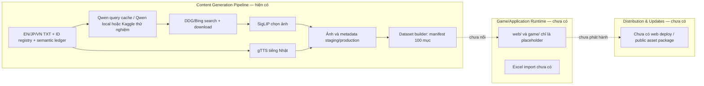

# 01 — Kiểm kê hiện trạng dự án

**Ảnh chụp:** 22/11/2026, working tree tại `936d9fdd27810e50a144fb6399e647b1ba18c371`. `git status --short` có file sửa và nhiều file chưa theo dõi, gồm `kaggle_batch/`, workflow, các runner và báo cáo staging; kiểm kê này bao gồm chúng. **Verified** = đối chiếu trực tiếp mã/file hoặc kiểm tra offline trong lần khảo sát; **Inferred** = suy luận có căn cứ; **Unknown** = chưa có phép đo hoặc bằng chứng. Các số liệu về chất lượng do báo cáo lịch sử ghi nhận được dẫn nguồn, không được xem là review mới.

## Kiến trúc AS-IS

**Verified:** `web/` và `game/` không có source runtime; `README.md:1-2` và `projectframework.md:1-17` mô tả mục tiêu, không phải triển khai. Không thấy backend/API của trò chơi, framework frontend, script build hoặc workflow deploy web. Workflow `.github/workflows/kaggle_qwen3_4b_batch.yml` chỉ điều phối thí nghiệm Kaggle; không có Dockerfile/Compose/manifest Kubernetes. `projectframework.md:17` gọi Excel import là tính năng tương lai; không có `.xlsx`, parser Excel hay dependency `openpyxl`/`pandas` trong source hoặc requirements. **Thông tin sản phẩm từ chủ dự án:** Excel import theo mẫu bắt buộc là chức năng trọng tâm; 100 từ hiện tại chỉ là benchmark model, không phải giới hạn sản phẩm.

Pipeline hiện kết hợp model, mạng và filesystem **trong lúc chuẩn bị nội dung**: `collect data script/imagecollector.py:757-838` gọi `prepare_queries`, rồi search và SigLIP; `query_generator.py:91-296` tải model khi cache thiếu; `audiocollector.py:166-179` gọi gTTS; `dataset_builder.py:42-153` liên kết nguồn và media. Không có đường gameplay gọi AI vì gameplay chưa được viết. Các bước kiểm tra cấu trúc TXT, đối chiếu registry, dựng manifest và đọc media đã lưu có thể chạy offline (`validate_vocabulary.py:1-79`, `dataset_builder.py:125-153`). Tìm ảnh, gTTS và remote Qwen cần mạng; Qwen/SigLIP local cần model và tài nguyên trên máy chạy pipeline.

## Trạng thái module

| Module | Implemented | Tested | Working | Issues | Evidence |
|---|---|---|---|---|---|
| Vocabulary + stable ID/decision | Có | Có | Cấu trúc đạt | 20 nghĩa chờ quyết định, 77 chưa review | `validate_vocabulary.py:1-79`; `data/vocabulary/unified_dataset_v1.json`; kiểm tra 100 hàng, 0 lỗi |
| Qwen query local/cache | Có | Có | Có output lịch sử | 100 query parse không chứng minh đúng nghĩa; 94 thiếu raw accepted output | `query_generator.py:91-296`; `reports/image_pipeline_audit/20261106T102750Z-cd93f8a1/audit_statistics.json` |
| Image search/download/SigLIP | Có | Có | Staging kỹ thuật | Ảnh sai nghĩa, chữ/watermark, bản quyền chưa duyệt | `imagecollector.py:149-838`; `stage_vocabulary_images.py:395-423`; `reports/full_media_staging_review.md:49-79` |
| Audio gTTS + staging | Có | Có | 100 MP3 staged hợp lệ kỹ thuật | 0 production MP3; quyền phân phối và nghe duyệt còn thiếu | `audiocollector.py:166-179`; `stage_japanese_audio.py:197-221`; `reports/full_media_staging_inventory_v1.json:totals` |
| Dataset builder | Có | Có | Manifest lưu khớp bản dựng read-only | Chưa có media URL công khai hoặc rule promote `available` | `dataset_builder.py:42-153`; kiểm tra read-only ngày 22/11 |
| Kaggle/Cloudflare Qwen4B | Nháp thí nghiệm | 19 test mock | Live chưa xác minh | Catalog rỗng, V4 D1 chỉ `prepared` | `kaggle_batch/approved_experiments.json`; `docs/KAGGLE_BATCH_AUTOMATION_ARCHITECTURE.md:154-162`; D1 manifest |
| Excel import, game, backend, web deploy | Không | Không | Không | Chưa có interface, runtime hoặc URL | `projectframework.md:1-17`; `web/`, `game/`, `.github/workflows/` |

Chạy kiểm tra offline trong lần khảo sát: collector `unittest` **160/160 pass**, Kaggle mock **19/19 pass**, validator **100 hàng/0 lỗi**; `build_dataset(root)` bằng đúng JSON đã lưu. Các test này chứng minh hành vi offline được mô phỏng, không chứng minh inference, provider, bản quyền hoặc trải nghiệm game live.

## Kiểm kê 100 từ và mức sẵn sàng

**Verified:** manifest production có 100 mục: ảnh `needs_review=10`, `missing=90`; audio `missing=100`; public URL ảnh/audio đều 0 (`data/vocabulary/unified_dataset_v1.json`, `dataset_builder.py:42-120`). Inventory staging ghi 100 audio MP3 hợp lệ kỹ thuật, 89 ảnh mới và tổng 99/100 ID có ảnh được chọn; ID 038 bị chặn do thiếu image intent. Tất cả 199 đường dẫn media trong inventory tồn tại, kích thước khớp manifest; tổng ảnh được chọn 12,601,002 byte, audio 808,896 byte. Đây **không phải** kích thước gói phát hành: inventory ghi `promotion_eligible_now=0`, `game_ready_now=0`, `public_media_urls=0` (`reports/full_media_staging_inventory_v1.json:totals`).

Báo cáo review ghi 29/89 ảnh staged có vấn đề quan sát được; 60 ảnh còn lại chưa được xác nhận phù hợp. Hai ảnh production rice/chicken sai nghĩa, 16 ID có lỗi nghĩa đã biết; 98 ảnh có `license_status=unknown`, một candidate bị hạn chế, một candidate được xác minh quyền nhưng chưa promote. Audio: 10 hash được duyệt nghe, 10 nhận phản hồi chung chưa duyệt từng hash, 80 chưa duyệt; quyền phân phối của cả 100 chưa giải quyết (`reports/full_media_staging_review.md:22-28,75-92`; inventory từng record). Trong ledger Qwen 100 từ, `query_quality_flag` ghi **35 `needs_semantic_review` và 65 `not_independently_validated`**; cả 25 hàng query gate Variant B đều `skipped` vì thiếu nhãn hoặc nghĩa chưa quyết định (`reports/image_pipeline_audit/20261106T102750Z-cd93f8a1/02_qwen_queries_100.csv`; `reports/image_pipeline_benchmark/20261107-image-retrieval-c0-v1/evaluation/query_gate.csv`). 100 query parse và 100 MP3 kỹ thuật **không phải** kết quả model đạt 100/100 về nội dung. Lỗi ảnh cũng không tự động chứng minh query Qwen là nguyên nhân; cần phân loại theo bước lỗi.

## Phụ thuộc và phần có thể tái sử dụng

**Inferred:** Python pipeline, stable ID, ledger, staging manifests, validation và dataset builder có thể tái sử dụng bất kể web/native vì không phụ thuộc runtime. Chỗ cần thêm là ranh giới xuất bản một **content pack đã duyệt** và hợp đồng Excel import. **Unknown:** thời gian tải gói trên thiết bị phổ thông, dung lượng cache offline theo trình duyệt, thời gian xử lý Excel tùy ý, concurrency người dùng, độ ổn định API Kaggle live. Không có cơ sở để nói chuyển Native sẽ giải quyết chúng.
