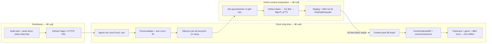

# 04 — Kiến trúc khuyến nghị

## Quyết định kiến trúc

**Khuyến nghị có điều kiện: PARTIALLY ADOPT.** Tách AI/content pipeline khỏi gameplay như đề xuất, nhưng **không chuyển sang Native App hay game engine cho MVP**. Chọn game web phục vụ công khai và hỗ trợ offline sau khi nội dung đã được lưu; backend xử lý **bộ Excel mới**, không phục vụ từng thao tác chơi. Đây là TO-BE, không phải chức năng hiện có. Bằng chứng AS-IS: `web/` và `game/` trống; `collect data script/imagecollector.py:757-838`, `audiocollector.py:166-179` chạy tác vụ chuẩn bị nội dung; `dataset_builder.py:42-120` chưa xuất public media URL.

**Ranh giới bắt buộc:** trình duyệt không gọi Qwen/SigLIP/gTTS trong gameplay. Import Excel và xử lý media cần mạng; trạng thái `processing`/`needs_review` không chơi như item hoàn tất. Chỉ pack `ready` mới được tải và dùng offline. Static host chỉ phân phối client/pack; dịch vụ xử lý Excel cần triển khai riêng. Nếu dịch vụ chưa có trước hạn nộp, yêu cầu “người học nhập Excel rồi tự động có ảnh/audio” **chưa đạt**, dù trang web đã công khai. Không dùng Kaggle Quick Tunnel làm backend production (`03_ai_infrastructure_assessment.md`).

## Hợp đồng Excel v1 đề xuất

Do repo chưa có workbook/parser (`projectframework.md:17`, tìm kiếm source và requirements ngày 22/11), định nghĩa **mẫu mới** để triển khai thử; không coi đây là hợp đồng hiện hành:

| Thành phần | Quy tắc đề xuất |
|---|---|
| Định dạng | `.xlsx` thường, một sheet tên `Vocabulary`; từ chối macro/định dạng khác. |
| Hàng 1 | Header chính xác `english`, `japanese`, `vietnamese`; thêm `target_sense` tùy chọn để làm rõ từ đa nghĩa. |
| Hàng dữ liệu | Mỗi hàng là một bộ EN/JP/VN; ba cột bắt buộc là text không rỗng sau trim. Giữ chỉ số hàng Excel trong thông báo lỗi. |
| Xem trước | Báo ô thiếu, trùng bộ ba, loại dữ liệu sai và từ đa nghĩa cần duyệt **trước** khi tạo job hay tiêu quota model. Không âm thầm dịch/chọn nghĩa. |
| Định danh | Tạo `import_id` riêng và `item_id` ổn định trong bộ nhập; không dùng lại `vocab-000001…100` của benchmark. Lưu source row, bản sửa và trạng thái review. |
| Đầu ra | Pack theo version gồm bộ ba gốc, nghĩa/nguồn quyết định, đường dẫn media nội bộ, hash, quyền sử dụng, trạng thái `ready` hoặc lý do lỗi; không xuất local path/secret hay file chưa duyệt. |

`target_sense` chỉ là ý định người nhập, **không tự động là phê duyệt của chủ dự án**. Mẫu 3–5 hàng cho MVP để thử từ đầu đến cuối; số 100 hiện tại là tập đánh giá model, không đặt giới hạn 100 hàng cho sản phẩm. Giới hạn kích thước workbook, số hàng/job và thời gian chờ phải chốt từ thử nghiệm hiệu năng/chi phí, không suy ra từ benchmark hiện có. File API cho phép người học chọn file local trong browser ([MDN](https://developer.mozilla.org/en-US/docs/Web/API/File_API/Using_files_from_web_applications)); `.xlsx` vẫn cần parser được chọn/kiểm thử ở giai đoạn triển khai.

## Tái sử dụng, phát hành và cập nhật

**Giữ:** Python collectors, registry/decision ledger, cơ chế staging, metadata, kiểm tra kỹ thuật và builder (`collect data script/`, `data/vocabulary/`). **Điều chỉnh:** xuất pack theo import, mapping stable ID, trạng thái review, URL hoặc blob tham chiếu và manifest checksum. **Xây mới:** Excel reader/preview, service job cho import tự phục vụ, giao diện học/chơi, offline cache, workflow phát hành web. Không có gameplay hiện tại để “viết lại”.

**Nếu xét Native về sau:** giữ pipeline/nguồn từ vựng và ảnh/audio đã duyệt; web wrapper chỉ tái sử dụng runtime web **sau khi nó tồn tại**, còn game engine cần viết lại gameplay, nhập file, phát audio, lưu tiến độ và cơ chế cập nhật. Đừng di chuyển/ghi đè registry, ảnh, MP3 hoặc metadata để “migration”; kiểm tra stable ID, hash và bản pack trước/sau. Duy trì đồng thời web và native tạo hai bộ build, test, phân phối asset và hỗ trợ lỗi. Docker là tùy chọn đóng gói worker online khi đã có host; không cần Kubernetes cho kiến trúc đề xuất (`03_ai_infrastructure_assessment.md`).

Kho GitHub hiện public và chưa có workflow web deploy; [GitHub Pages hỗ trợ xuất site bằng GitHub Actions](https://docs.github.com/en/pages/getting-started-with-github-pages/configuring-a-publishing-source-for-your-github-pages-site). Chỉ upload **artifact web sạch**, không xuất cả repo, raw Excel, staging, model, log hoặc media chưa rõ quyền. URL dự án có path tiền tố tên repository; kiểm thử routing/asset bằng đúng URL thật. Dùng HTTPS/service worker để lưu app shell và pack; [service worker có thể cache resource cho offline](https://developer.mozilla.org/en-US/docs/Web/API/Service_Worker_API/Using_Service_Workers), nhưng phải đo quota và thử mất mạng. Pack mới được tải sau khi duyệt và xác minh hash; pack cũ vẫn dùng được nếu update lỗi. Không hứa tự động cập nhật khi đang offline.

## Điều kiện đổi hướng

Nếu cổng chất lượng model 100 từ hoặc quyền media không đạt, **dừng việc coi nội dung là game-ready** và sửa pipeline/review trước. Nếu thử nghiệm browser trên máy mục tiêu thất bại về lưu trữ/offline hoặc giáo viên yêu cầu bản cài, xét packaged desktop trên cùng content contract; không đưa Qwen vào gameplay chỉ vì đổi nền tảng. Nếu dịch vụ Excel→media không thể phát hành ổn định trước 2/12, báo rõ tính năng chưa hoàn tất và xin điều chỉnh phạm vi nộp; không dùng một demo dữ liệu cố định để giả làm import tùy ý.
