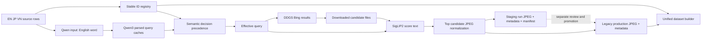

# Image pipeline architecture and evidence boundaries

This describes the executed local implementation, not the historic roadmap. Source references are relative to the project root.

| Boundary | Responsible implementation | Input and output | Persistence, validation and failure behavior |
|---|---|---|---|
| Source to ID | `vocabulary_registry.py:load_registry`, `validate_registry`; `dataset_builder.py:build_dataset` | Physical aligned EN/JP/VN rows to `vocab-000001`–`000100` | Exact triple and stable registry checked. Source and registry persist under `data/vocabulary/`; an unrecorded edit fails. |
| Word to Qwen | `query_generator.py:QwenQueryGenerator._generate_raw`, `_generate_chunk`, `prepare_queries`; staging `prepare_staging_queries`, `repair_failed_staging_queries` | **Only English word** in `Input: <word>\nQuery:` under a fixed system prompt | Model `Qwen/Qwen3-1.7B`, batch size 2, `max_new_tokens=32`, `do_sample=False`, `enable_thinking=False`, EOS required. Model uses automatic device placement, float16 on CUDA. Cache signature hashes ordered 100-word list, model, system prompt, token limit and thinking flag. Raw accepted text is normalized and normally discarded. One invalid-output retry uses a correction instruction. Six separately corrected verbs preserve `corrected_raw_output` and earlier failure text in sparse cache. |
| Parsed query to effective query | `semantic_decisions.py:select_effective_query`; `stage_vocabulary_images.py:choose_targets` | Qwen query plus approved ledger | IDs 004/009 use owner-approved `cooked rice`/`chicken meat`. ID 038 has approved singular friend sense but no image intent and is blocked before search. All other IDs use Qwen query as `model_generated_unreviewed`. No heuristic fallback query is in this path. |
| Query to search results | `imagecollector.py:search_images`, `normalize_ddg_results` | Effective query; DDGS `backend=bing`, `region=wt-wt`, `safesearch=moderate`, at most 3 results in generic staging | Retry bounded by run configuration (normally 1 retry). Raw/valid counts and selected URL persist in manifest; **full candidate result list does not**. Invalid/duplicate URLs are filtered. Search failures are recorded per target. |
| Results to downloaded candidates | `imagecollector.py:download_candidate_images`, `request_with_retry`, `validate_image_bytes` | Normalized result URLs to local `_candidates/<word>/*.img` | URL safety, payload and dimensions checks. Per-candidate failures print to console and processing continues, but reasons and full URLs do not persist in run manifests. Cache is cleaned before and after processing; audit found zero `.img` files. |
| Candidates to ranked winner | `imagecollector.py:choose_image_result_with_siglip`; `image_scorer.py:SiglipImageScorer.score_batch` | **Effective query text** plus decoded RGB candidate images | `google/siglip2-so400m-patch16-384`; processor tokenizes one query and images with max-length padding; `logits_per_text` are sorted descending. Candidate scores print to console only. Selected score/model persist in JPEG metadata and manifest. There is no calibrated acceptance threshold or independent semantic verification. |
| Winner to JPEG | `imagecollector.py:normalize_image_to_jpeg`, `metadata_from_result`, `process_word` | Selected candidate image to EXIF-transposed RGB JPEG, max 1024×1024, quality 90 | JPEG/word/query/provider/source/score metadata stored. Generic staging adds SHA-256, dimensions and per-ID status to run manifest; resume verifies hash and metadata. Failed target does not replace earlier run. |
| Production and dataset | `data/image/en/*.jpg`, `_metadata/*.json`; `dataset_builder.py:image_record`, `build_dataset` | Production files only to saved `unified_dataset_v1.json` | Builder checks JPEG decode and metadata word/provider. It does not include staged images or audio, so saved dataset still has 10 production images and 0 production MP3s. Existing rice/chicken production query mismatch remains visible as `needs_review`. |

## Material provenance gaps

1. The normal Qwen cache stores **parsed queries**, not decoded raw outputs. Accepted raw text is recoverable only for the six corrected verb records. Cache has model ID and signature but no generation timestamp, model revision, per-token log or per-record inference attestations.
2. The sparse cache's six initial rejected outputs survive as validation error strings; they should not be confused with the later accepted raw output or effective query.
3. DDGS candidate lists and per-candidate SigLIP scores were not serialized. The selected source URL and its score survive, but losing alternatives prevents a defensible search-versus-ranking attribution.
4. Candidate byte files were cleaned as designed. Historical retrieval cannot be replayed exactly because Bing indices and remote URLs can change.
5. Generic run manifests retain original retrieval counts after resume; `resume_cache_status=cache_hit` overwrites the immediate status view. Historical first-pass download counts are corroborated by the prior staging report, not by a separate immutable event log.
6. The production JPEG metadata has no stable ID, run ID or file hash. The dataset joins by exact English filename and validates the word. The current 10 joins pass, but a future duplicate word would need a stronger identity boundary.

## Observed versions

The audit indexed 14 image run manifests with 101 target events. It found 10 production JPEGs and 92 staging JPEG versions (89 new generic images plus three rice/chicken replacements). IDs 004 and 009 have multiple versions; the lineage JSON lists every version and the prior inventory's selected path without implying owner promotion approval.
